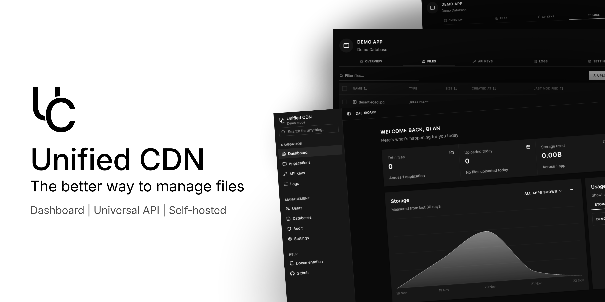

# ☁️ Unified CDN 📂
Unified CDN is a robust, **all-in-one** file storage network. It works as a proxy, sitting between your application and various file storage providers, and adding features across all your providers.

Visit the [documentation](https://docs.unified-cdn.ngqian.com) to deploy and set up.

Not ready yet? Visit the [demo](https://docs.unified-cdn.ngqian.com/dashboard/demo) to try Unified CDN out first.

## Features
- Unified API: Use a **single REST API** framework to get, upload, rename and delete files across 4 different providers.
- Dashboard: Add your file storage providers, **manage access** to projects, and **invite** your friends from a very nicely made dashboard :p
- Analytics: Track **file size changes** and set **storage limits** so u never get charged extra
- **4 file providers**: Supports Cloudflare R2, Blackblaze B2, Amazon S3 and Hackclub CDN.
- Grant codes: Lets you upload files directly from **client** pages, even **easier** than presigned URLs, and adding **client-side functionality** to Hackclub CDN.
- Self-hosted: Runs on your own servers so ur files always stay **yours**!
- Comprehensive docs: So you never get **confused or lost** 

## Future plans
- [ ] File API 2.0: Files can expire, become private, queried by tags and sorted into folders
- [ ] Ability change application database & automigrate data
- [ ] Ability to change database's provider & automigrate data
- [ ] Add multiple databases for a single application (can configure how files are stored, such as large files going into a different database)
- [ ] Add multiple providers for a single database (same thing as above)
- [ ] Add more providers, like Oracle and Google
- [ ] Add a python sdk too